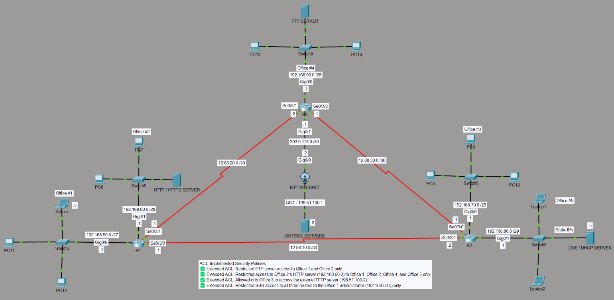

# Enterprise Network Practice: Multi-Office Routing, PAT, ACL Policies and Secured SSH Management

A Cisco Packet Tracer lab that connects five office networks through three routers and an ISP, then layers on **PAT (NAT overload)**, **extended ACL access policies**, and **SSH management restricted to a single admin host**.

> All addresses and credentials in this repository are **lab-only**. Passwords and hashes have been replaced with placeholders.



## Objectives

- Design and verify an addressing plan with right-sized subnets (/27, /28, /29, /30).
- Build internal connectivity with OSPF and advertise a default route from the edge router.
- Provide Internet access with PAT on the edge router and read the translation table.
- Control access between offices and to servers with extended ACLs.
- Restrict router management to one admin host using SSH and a VTY `access-class`.

## Topology and addressing

| Network | Subnet | Gateway | Notes |
|---|---|---|---|
| Office 1 | 192.168.50.0/27 | R1 Gi0/0 (.1) | Admin host: 192.168.50.5 (static) |
| Office 2 | 192.168.60.0/28 | R1 Gi0/1 (.1) | HTTP/HTTPS server: 192.168.60.3 |
| Office 3 | 192.168.70.0/29 | R2 Gi0/0 (.1) | |
| Office 5 (services) | 192.168.80.0/29 | R2 Gi0/1 (.1) | DNS/DHCP server: .5 |
| Office 4 | 192.168.90.0/28 | R3 Gi0/0 (.1) | FTP server |
| R1 to R2 | 12.88.10.0/30 | R1 Se0/3/0 (.1), R2 Se0/3/1 (.2) | Transit link |
| R1 to R3 | 12.88.20.0/30 | R1 Se0/3/1 (.1), R3 Se0/3/1 (.2) | Transit link |
| R2 to R3 | 12.88.30.0/30 | R3 Se0/3/0, R2 Se0/3/0 | Transit link <!-- TODO: confirm host addresses (.1 / .2) --> |
| R3 to ISP | 203.0.113.0/30 | R3 Gi0/1 (.1), ISP Gi0/0 (.2) | Edge link |
| Outside LAN | 198.51.100.0/24 | ISP Gi0/1 (.1) | Outside servers at .2 |

The 203.0.113.0/24 and 198.51.100.0/24 ranges are reserved documentation addresses, used here to simulate public space. The 12.88.0.0 transit links are lab addresses.

## Implementation

### 1. Routing
- OSPF runs on R1, R2 and R3 so every office can reach every other.
- R3 has a static default route to the ISP and advertises it with `default-information originate`.
- R1 and R2 learn the default route as an OSPF external route (`O*E2`).
- The ISP has no routes to the private networks, as on a real provider, which is why NAT is required.

### 2. PAT on R3
All office networks are translated to R3's ISP-facing address.

```
ip access-list standard PAT-INSIDE
 permit 192.168.50.0 0.0.0.31
 permit 192.168.60.0 0.0.0.15
 permit 192.168.70.0 0.0.0.7
 permit 192.168.80.0 0.0.0.7
 permit 192.168.90.0 0.0.0.15
!
ip nat inside source list PAT-INSIDE interface GigabitEthernet0/1 overload
!
interface GigabitEthernet0/0
 ip nat inside
interface Serial0/3/0
 ip nat inside
interface Serial0/3/1
 ip nat inside
interface GigabitEthernet0/1
 ip nat outside
```

Only R3 performs NAT. R1 and R2 route private addresses unchanged, which avoids double NAT.

### 3. Access policies (extended ACLs)

| # | Policy | Applied on |
|---|---|---|
| 1 | Only Offices 1 and 2 can access the FTP server | <!-- router / interface / direction --> |
| 2 | Only Offices 1, 2, 4 and 5 can access the Office 2 HTTP server (192.168.60.3) | <!-- router / interface / direction --> |
| 3 | Only Office 3 can use TFTP on the outside server (198.51.100.2) | <!-- router / interface / direction --> |

### 4. Secured management access
Only the Office 1 admin host (192.168.50.5) may SSH to R1, R2 and R3. Configured on each router, alongside the usual SSH prerequisites (hostname, domain name, local user, RSA key, `ip ssh version 2`):

```
ip access-list extended SSH-ADMIN
 permit tcp host 192.168.50.5 any eq 22
 deny ip any any log
!
line vty 0 15
 access-class SSH-ADMIN in
 transport input ssh
 login local
```

## Verification

| Test | Expected result | Evidence |
|---|---|---|
| Office PCs reach the outside server over HTTP, HTTPS, FTP | Succeeds; entries in `show ip nat translations` | translations.png |
| Admin (192.168.50.5) SSH to R1, R2, R3 | Succeeds | `screenshots/ssh-admin-success.png` |
| Any other host SSH to a router | Refused; deny counter increases | `screenshots/ssh-denied.png` |
| Office 3 to outside TFTP (UDP 69) | Succeeds | `screenshots/tftp-office3.png` |
| Other offices to outside TFTP | Blocked | `screenshots/tftp-blocked.png` |
| Offices other than 1 and 2 to the FTP server | Blocked | `screenshots/acl-hit-counters.png` |

Sample PAT translation table from R3:

```
Pro  Inside global      Inside local       Outside local       Outside global
tcp  203.0.113.1:1024   192.168.50.2:1025  198.51.100.2:443    198.51.100.2:443
tcp  203.0.113.1:1025   192.168.50.3:1025  198.51.100.2:80     198.51.100.2:80
tcp  203.0.113.1:1027   192.168.60.2:1025  198.51.100.2:21     198.51.100.2:21
tcp  203.0.113.1:1034   192.168.50.5:1034  198.51.100.2:21     198.51.100.2:21
```

Hosts from several offices share 203.0.113.1. When two hosts pick the same source port (192.168.50.2 and 192.168.50.3 both used 1025), PAT remaps one of them (1025 became 1024), so each session stays unique.

Useful commands: `show ip nat translations`, `show ip nat statistics`, `show access-lists`, `show ip interface`, `show ip ssh`.

## Lessons learned

- Standard ACLs go close to the destination; extended ACLs go close to the source.
- ACLs end with an implicit deny, so permits for DHCP relay and SSH must be added deliberately.
- A VTY line uses `access-class`, while an interface uses `ip access-group`.
- NAT translates any matching source regardless of whether the destination exists, so a mistyped address still creates entries.
- The default route handles the outbound path; the return path needs NAT or a route on the ISP.
- PAT tells sessions apart by port and remaps a source port when two hosts collide.
- Use static addresses for management hosts so an ACL entry does not break when a DHCP lease changes.

## Repository structure

```
.
├── README.md
├── .gitignore
├── configs/        R1.txt  R2.txt  R3.txt  ISP.txt   (sanitized)
└── screenshots/    topology, NAT table, ACL hit counters, SSH and TFTP tests
```

## Skills demonstrated

IPv4 subnetting, OSPF, default routing, PAT/NAT, standard and extended ACLs, VTY hardening, SSH, DHCP relay awareness, and structured network troubleshooting.
